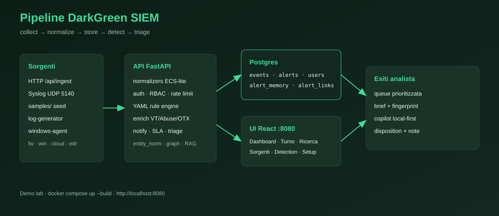
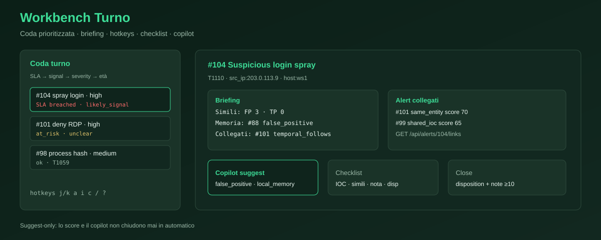
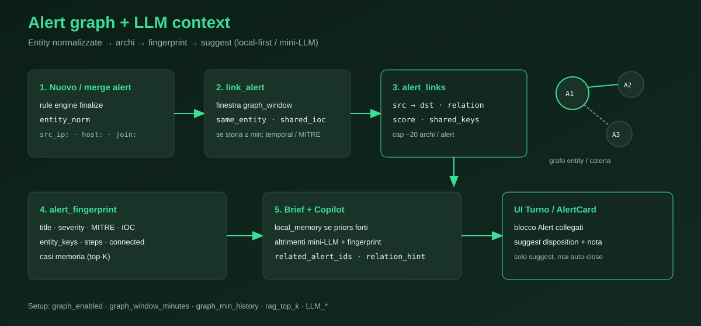

# DarkGreen SIEM

[](LICENSE)
[](docker-compose.yml)
[](services/api)
[](web)

**Demo SIEM multi-fonte** in un comando: ingest, normalizzazione ECS-lite, ricerca da analista, dashboard e detection YAML con workflow alert e link VirusTotal sugli IOC.

Parte del portfolio [DarkGreen Projects](https://github.com/DarkGreen-projects).


## Cosa fa

| Area | Dettaglio |
|------|-----------|
| **Ingest** | HTTP `/api/ingest`, syslog UDP `5140`, seed `samples/`; traffico continuo solo con `--profile demo` |
| **Normalizzazione** | FortiGate syslog KV + windows / cloud_auth / **siem_export Cynet** (process, hash, MITRE labels) |
| **Auth / RBAC** | Soft multi-tenant + ruoli admin/analyst/viewer/ingest |
| **TLS / HA** | Overlay Compose TLS + 2 API dietro nginx |
| **Ricerca** | Query `field:value` + free-text; ricerche predefinite |
| **Dashboard** | EPS, timeline, health, filtri stato/MITRE/SLA, export CSV (polling lean) |
| **Turno** | Workbench coda, briefing, **alert collegati**, hotkeys, checklist, pivot |
| **Setup lab** | Retention, silence, purge, TI, webhook, **SLA**, **RAG**, **Alert graph**, **Copilot** |
| **Detection** | YAML match / threshold / correlation; dry-run; `labels.*` |
| **Alert workflow** | Disposition/note; MITRE; dedup; SLA; triage; Memory RAG; alert graph; copilot |
| **Sorgenti / host** | **Installer EXE** + agent lean; [setup](docs/setup-guide.md) · [collectors](docs/collectors-windows-syslog.md) |
| **VirusTotal / TI** | VT, AbuseIPDB, OTX in Setup + verdict in cache |

Documentazione: [docs/README.md](docs/README.md) · Setup lean: [docs/setup-guide.md](docs/setup-guide.md) · Architettura: [docs/architecture.md](docs/architecture.md)

## Avvio rapido

Guida completa: [docs/setup-guide.md](docs/setup-guide.md).

```bash
cp .env.example .env   # ruota i secret
docker compose up --build
```

Default **lean**: niente `log-generator`, limiti memoria/CPU, `RULE_INTERVAL_SEC=30`. Traffico demo:

```bash
docker compose --profile demo up --build
```

Apri **http://localhost:8080** e accedi con le credenziali lab (default `analyst` / `darkgreen`).

| Endpoint | URL |
|----------|-----|
| UI | http://localhost:8080 |
| API docs | http://localhost:8000/docs |
| Syslog UDP | `localhost:5140` |

Stop: `Ctrl+C` oppure `docker compose down`.

### Installer host (EXE)

Da **Sorgenti** scarica `connect-installer.zip` → sul PC `DarkGreen-Setup.cmd` (o `dist/DarkGreen-Setup.exe`). Passi: compatibilità PC, rete, health, heartbeat, agent/NXLog.

### Auth lab (abilitata di default)

In Compose l’API richiede un Bearer token su `/api/*` (eccetto `POST /api/auth/login` e `/health`):

- **UI**: login username/password → token HMAC (TTL ~12h) in `localStorage`
- **Utenti bootstrap**: `analyst` / `darkgreen` (ruolo **admin**), `viewer` / `viewer` (solo lettura)
- **Ruoli**: `admin` (setup/purge), `analyst` (alert/regole/enrich), `viewer` (GET), `ingest` (machine token)
- **Multi-tenant soft**: colonna `tenant_id` (default `lab`); ogni utente vede solo il proprio tenant
- **Ingest / log-generator**: header `Authorization: Bearer <SIEM_API_TOKEN>` (ruolo ingest)
- **Playground aperto**: `AUTH_ENABLED=false` richiede anche `ALLOW_INSECURE_NO_AUTH=true` (anti-misconfig)
- Syslog UDP: max 64 KiB/datagram + rate limit per host (200/s)

### Lean ops e performance

- **Compose lean di default**: niente `log-generator` (usa `--profile demo`); `mem_limit` / `cpus` su postgres/api/web/generator; `RULE_INTERVAL_SEC=30`
- **UI**: polling con pausa tab nascosta; niente doppio `/api/stats` sulla dashboard
- **API**: timeline stats a query unica; liste alert senza N+1 commenti/audit
- **`events.raw`**: zlib sopra ~512 byte (`ZLIB1:`); log API rotanti; Docker log `max-size=10m`
- Dettaglio avvio: [docs/setup-guide.md](docs/setup-guide.md) e [`.env.example`](.env.example)

### TLS (lab HTTPS)

```bash
# genera cert self-signed in deploy/certs/
bash scripts/gen-tls.sh
# oppure: powershell -File scripts/gen-tls.ps1

docker compose -f docker-compose.yml -f docker-compose.tls.yml up --build
```

UI HTTPS: **https://localhost:8443** (warning browser sul self-signed). L’API non e pubblica su `:8000`. Syslog UDP resta plaintext su `5140`.

### HA lab (2 API)

```bash
docker compose -f docker-compose.yml -f docker-compose.ha.yml up --build
```

Nginx bilancia `api` + `api-b`. Postgres resta single-node (failover DB fuori scope). Override Setup (key TI, retention) sono in tabella `lab_settings` condivisa.

### Setup lab (retention e silence)

Tab **Setup** in UI (o env Compose):

| Env | Default | Ruolo |
|-----|---------|--------|
| `RETENTION_DAYS` | `7` | Cancella eventi più vecchi di N giorni (`0` = off) |
| `HEALTH_STALE_MINUTES` | `5` | Soglia health `stale` |
| `HEALTH_SILENT_MINUTES` | `30` | Soglia health `silent` + cooldown alert ops |
| `SILENCE_ALERTS_ENABLED` | `true` | Alert `source-silent-*` se una sorgente tace |
| `PURGE_INTERVAL_SEC` | `300` | Intervallo job purge/silence |

API: `GET/PATCH /api/setup`, `POST /api/admin/purge`, `GET /api/alerts/export.csv`.

### VirusTotal enrichment

Imposta le API key in **Setup → Enrichment API** (o env Compose). Provider supportati:

| Env / Setup | Provider |
|-------------|----------|
| `VT_API_KEY` | VirusTotal |
| `ABUSEIPDB_API_KEY` | AbuseIPDB |
| `OTX_API_KEY` | AlienVault OTX |
| `VT_CACHE_TTL_HOURS` | TTL cache (default 24) |

Senza key restano i link GUI. Con key: `GET /api/enrich` (multi) e `GET /api/enrich/vt`. Le regole `correlation` possono avere uno step `enrich` (vedi `rules/spray-then-malicious-ip.yml`).

### Notifiche Slack / Teams

Webhook HTTPS su alert **aperti** con severity >= soglia (default `high`). Solo al primo create, non a ogni merge.

| Env / Setup | Default | Ruolo |
|-------------|---------|--------|
| `NOTIFY_WEBHOOK_URL` | (vuoto) | Incoming Webhook URL |
| `NOTIFY_FORMAT` | `slack` | `slack` o `teams` |
| `NOTIFY_MIN_SEVERITY` | `high` | Soglia minima |

Configurabile anche da **Setup → Notifiche**.

### SLA alert (ack + close)

Minuti massimi per severity, configurabili in **Setup → SLA alert** (o env JSON):

| Env | Esempio |
|-----|---------|
| `SLA_ACK_MINUTES` | `{"critical":15,"high":30,"medium":240,"low":1440}` |
| `SLA_CLOSE_MINUTES` | `{"critical":120,"high":480,"medium":1440,"low":10080}` |

- **Ack**: da creazione fino a uscita da `open` (`acked` / `in_progress`)
- **Close**: da creazione fino a `closed`
- Stati computed: `ok`, `at_risk` (>80%), `breached`, `met`, `na` (se minuti = 0)
- Filtro UI/API: `GET /api/alerts?sla=breached`

### Triage disposition e learning suggestivo

Alla chiusura di un alert sono obbligatori:
- **disposition**: `true_positive` | `false_positive` | `benign` | `duplicate` | `tuning_needed`
- **closure_note** (min 10 caratteri)

Lo score `risk_score` / `noise_hint` usa severity, MITRE, occurrences e priors dalle chiusure passate stessa regola+entity. Solo suggerimenti (badge + alert simili): **nessun blocco automatico**. Setup: toggle scoring + finestra giorni.

API: `GET /api/alerts/{id}/similar`, filtro `?disposition=`.

### Workbench Turno + Copilot + Alert Memory RAG

Tab **Turno**: coda `open`/`in_progress` ordinata (SLA breached > at_risk > likely_signal > severity > età), dettaglio con briefing locale, checklist in `sessionStorage`, pivot 1-click verso Ricerca.

Hotkeys (Workbench e card in focus): `j`/`k` navigazione, `a` ack, `i` in corso, `c` close dialog, `/` pivot, `?` aiuto.

**Alert Memory RAG** (portatile): a ogni chiusura l’alert entra in `alert_memory` (testo + FTS Postgres). Il suggest è **local-first** (priors forti → zero LLM), altrimenti mini-LLM con top-K casi dell’ambiente. Export JSON da Setup per hub esterni.

**Alert graph**: a create/merge normalizza `entity_keys` e scrive archi in `alert_links` (`same_entity`, `shared_ioc`; con storia sufficiente anche `temporal_follows` / `mitre_chain`). Brief e Copilot usano fingerprint strutturato + vicini del grafo (`related_alert_ids`).

| Endpoint | Ruolo |
|----------|--------|
| `GET /api/alerts/queue` | Coda prioritizzata |
| `GET /api/alerts/{id}/brief` | Briefing + fingerprint + connected + casi |
| `GET /api/alerts/{id}/links` | Vicini grafo |
| `POST /api/alerts/{id}/copilot-suggest` | Suggest `local_memory` / `llm_rag` (fail soft) |
| `GET /api/memory/stats` | Contatori memoria tenant |
| `GET /api/memory/export` | Export JSON (admin) |

Setup: toggle RAG + `rag_top_k`; Alert graph (`graph_enabled`, `graph_window_minutes`, `graph_min_history`); Copilot LLM opzionale (`LLM_*`).

### Connector host (installer EXE + agent lean)

Download da UI Sorgenti (o API):
- `GET /api/tools/connect-installer.zip` - WinForms/EXE wizard (compat, rete, health, auth, collezione) + script Linux
- `GET /api/tools/windows-agent.zip` - agent Security Event Log (default 60s) → `/api/ingest`
- `GET /api/tools/connect-wizard.zip` - alias legacy dello stesso pack installer

Canali ingest: `connect-wizard`, `windows-agent`. Build EXE: `tools/connect-installer/build_exe.ps1`.

### Cynet / siem_export, dry-run, MITRE, dedup

- **Cynet**: `normalize_siem_export` mappa process/hash/MITRE in `labels.*`; regole seed `cynet-malware-hash.yml`, `cynet-suspicious-process.yml`. Match YAML supporta `labels.hash`, `labels.process`, ecc.
- **Dry-run**: `POST /api/rules/dry-run` con array JSON o linee syslog; UI Detection → pannello Dry-run (nessuna scrittura alert).
- **MITRE**: campo `mitre` su YAML/regole; colonna `alerts.mitre`; badge e filtro `?mitre=` su Dashboard/Detection.
- **Dedup**: stessa `rule_id` + entity (`src_ip`/`host`/`user` o join_key) entro `cooldown_minutes` → merge (`evidence.occurrences`), non nuovo alert.

### Collectors Windows / syslog

Guida NXLog / rsyslog verso UDP 5140: [docs/collectors-windows-syslog.md](docs/collectors-windows-syslog.md).

## Query di esempio

```
action:deny
user:j.doe
source_type:windows AND action:login_failed
malware
src_ip:203.0.113.45
```

## Architettura

Pipeline demo ispirata a flussi collect → normalize → search → detect (nessuna affiliazione vendor). Dettaglio: [docs/architecture.md](docs/architecture.md).



```text
samples / syslog / HTTP  →  FastAPI + normalizers  →  Postgres
                                      ↓
                     YAML rules → alerts → memory + graph links
                                      ↓
        React UI (Dashboard · Turno · Ricerca · Sorgenti · Detection · Setup)
```

### Workbench e alert graph





## Struttura repository

```text
darkgreen-siem/
├── docker-compose.yml
├── rules/                 # regole detection YAML
├── samples/               # log multi-vendor fittizi
├── services/
│   ├── api/               # FastAPI, syslog, regole, RAG, graph, copilot
│   ├── normalizers/       # parser ECS-lite
│   └── log-generator/     # traffico demo (profile demo)
├── tools/                 # connect-installer (EXE) + windows-agent
├── web/                   # UI React + Vite (+ nginx)
├── docs/                  # setup, architettura, collectors, SVG
└── tests/                 # pytest
```

## Sviluppo locale

```bash
pip install -r services/api/requirements.txt
pytest -q

cd web && npm install && npm run dev
```

L’API richiede Postgres (`DATABASE_URL`). Il percorso più semplice resta `docker compose up`.

### Lab proof (report + immagini)

A ogni upgrade:

```bash
python -m tests.lab_proof
pytest tests/test_lab_proof_report.py tests/test_optimization_regressions.py -q
```

Output versionato anche in **[docs/lab-reports/latest/](docs/lab-reports/latest/)** (stesso contenuto di `tests/lab_proof/out/latest/`): `report.md`, `report.html`, `metrics.json`, `charts/*.svg`.

Indice report: [docs/lab-reports/README.md](docs/lab-reports/README.md).

## Ecosistema

| Progetto | Ruolo |
|----------|--------|
| [soc-automation-hub](https://github.com/DarkGreen-projects/soc-automation-hub) | Demo web SOC (VT, MITRE, decoder, pivot, bulk IOC) |
| [Decoder_SIEMjoson](https://github.com/DarkGreen-projects/Decoder_SIEMjoson) | CLI/GUI Python: parse SIEM + OSINT |

## Dati e sicurezza

- Sample con IP **RFC5737** e host/utenti fittizi.
- **Auth lab abilitata di default** (login + `SIEM_API_TOKEN`); resta un lab su rete privata, non esporre su Internet.
- Copia [`.env.example`](.env.example), ruota `AUTH_SECRET` / `SIEM_API_TOKEN` / password demo; con `STRICT_SECRETS=true` i default deboli bloccano l’avvio.
- Login rate-limited (429); OpenAPI disattivabile (`DISABLE_OPENAPI=true`); commenti firmati dal principal (no spoof author).
- Syslog UDP: size/rate limit + `SYSLOG_SHARED_SECRET` opzionale (prefisso `SECRET ` o `#dg-token=SECRET `). Non pubblicare `5140/udp` senza secret.
- Egress SSRF: notify/LLM solo `https` (o http se `ALLOW_INSECURE_WEBHOOKS`), blocco host privati/metadata, allowlist `EGRESS_HOST_ALLOWLIST`.
- Segreti Setup (API key, webhook, LLM) cifrati a riposo (Fernet da `AUTH_SECRET`); mask stretta in UI.
- Nginx: CSP + frame deny; API: header sicurezza + `Cache-Control: no-store` su `/api`.
- Connect wizard Linux: token solo da env/prompt (mai argv).

## Licenza

MIT - vedi [LICENSE](LICENSE).
