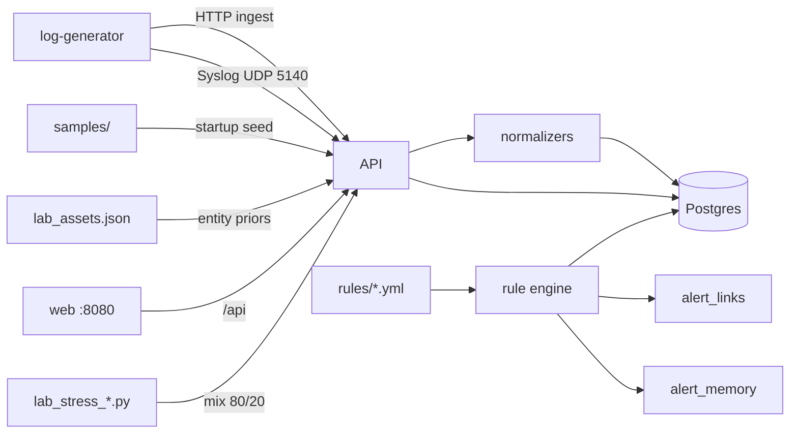
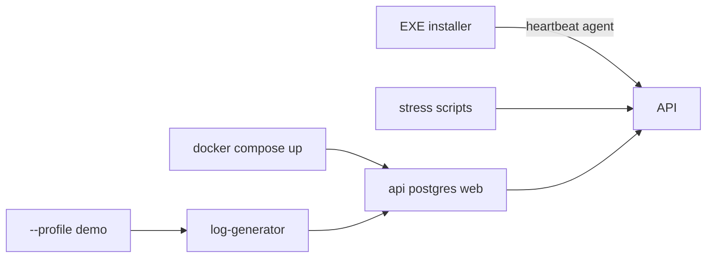
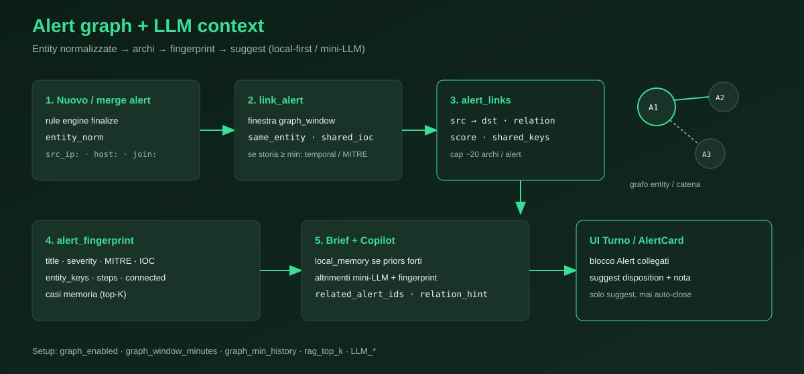
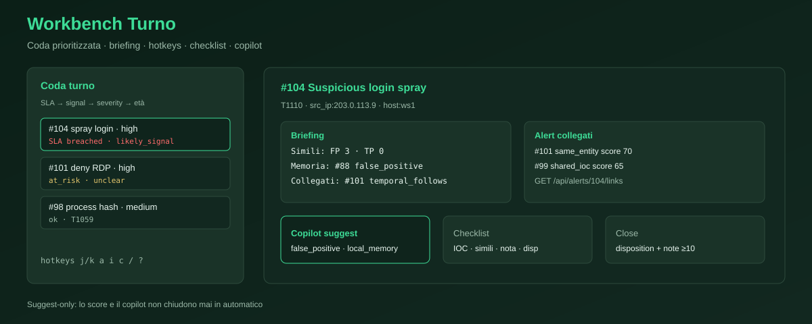

# Architettura

## Panoramica

DarkGreen SIEM è una **demo di portfolio** di una pipeline di log di sicurezza multi-fonte, ispirata ai flussi in stile LogPoint collect → normalize → search → detect. Non è affiliata a LogPoint/Guardsix e non è indurita per la produzione. Controlli di hardening lab: [security.md](security.md).

## Componenti

| Servizio | Ruolo |
|----------|-------|
| `postgres` | Store eventi + alert + `alert_memory` + `alert_links` + `rate_buckets` + audit Copilot |
| `api` | FastAPI ingest, search, stats, regole YAML, syslog UDP, RAG, graph, copilot, triage |
| `web` | UI React (Dashboard, Turno, Ricerca, Sorgenti, Detection, Setup) dietro nginx |
| `log-generator` | Traffico demo (Compose **profile `demo`**, off di default) |

## Schema normalizzato (ECS-lite)

`timestamp`, `source_type`, `vendor`, `device`, `host`, `user`, `src_ip`, `dst_ip`, `action`, `severity`, `message`, `raw`, `labels`, `ingest_channel`

## Tipi di sorgente

1. **firewall** - FortiGate syslog KV (PRI/header strip, traffic + UTM virus/IPS, labels: logid, type/subtype, intf, policy, url, attack, ...)  
2. **windows** - Windows Event JSON  
3. **cloud_auth** - auth in stile Entra/Okta  
4. **siem_export** - export EDR/SIEM JSON (shape Cynet): `Activity`→action, process/hash/MITRE in `labels` (`process`, `hash`, `technique`, …)

## Multi-tenant e RBAC

Soft tenancy: `tenant_id` su eventi/alert/IOC (default `lab`). Tabelle `tenants` / `users`. Ruoli:

- `admin` - Setup, purge, regole, export memory, bulk-close ampio
- `analyst` - search, alert write, regole, enrich, triage/copilot
- `viewer` - solo GET
- `ingest` - solo ingest (machine token)

Isolamento rigido per riga: nessun cross-tenant.

## TLS e HA lab

- TLS: `docker-compose.tls.yml` + certs in `deploy/certs/`
- HA: `docker-compose.ha.yml` (api + api-b, nginx upstream). Postgres single; `lab_settings` in DB per override condivisi.
- Solo `api` esegue rules/maintenance (`RUN_BACKGROUND_JOBS=false` su `api-b`).
- Rate limit condiviso via tabella `rate_buckets` (non solo memoria di processo).

## Sicurezza e storage (sintesi)

Dettaglio: [security.md](security.md).

- Syslog: secret obbligatorio + timing-safe + size/rate; purge/silence per tenant
- `STRICT_SECRETS`, `TRUST_X_FORWARDED_FOR`, `DISABLE_OPENAPI`, anti-misconfig auth
- Egress `url_safety` su webhook/LLM (https, no privati/CGNAT/metadata, allowlist)
- `lab_settings` sensibili: Fernet (`enc:`) da `AUTH_SECRET`
- Redazione LLM + sanitize RAG + `CopilotAudit`
- `events.raw` zlib se >512B; log API rotanti; Docker log max-size
- Installer: token non in chiaro negli argomenti Scheduled Task

## Ricerca

Linguaggio query demo: token `field:value` combinati con free-text opzionale (`AND` è ignorato come operatore). Esempio: `src_ip:203.0.113.45 AND action:deny`.

Filtro **Stato** alert, guida `?`, export CSV risultati.

## Detection

Regole YAML sotto `rules/`:

- `type: match` - qualsiasi evento recente che soddisfa i filtri sui campi (anche `labels.<key>` su JSONB)
- `type: threshold` - conteggio >= N raggruppato per un campo in una finestra temporale (`labels.*` supportati in SQL)
- `type: correlation` - due (o piu) step di match uniti su `join_on` (es. spray + login_success, spray + process)
- `mitre` - stringa o lista technique ID (persistita su alert)
- **Dedup/merge**: stessa rule + entity key entro `cooldown_minutes` aggiorna `evidence.occurrences` invece di creare un nuovo alert; rescore triage al merge
- **Fail-soft**: errore su una regola non ferma il ciclo; link graph con dedupe anti-`UniqueViolation`
- **Dry-run**: `POST /api/rules/dry-run` valuta in memoria senza scrivere alert
- **Notify**: webhook Slack/Teams su create di alert critical/high (Setup / env); skip rumorosi dove configurato
- **SLA**: minuti ack/close per severity; badge e filtro `?sla=`; `acked_at` / `closed_at`
- Esempio correlation recente: `rules/spray-success-process.yml`
- Asset lab tipizzati: `samples/lab_assets.json` + `lab_assets.py`

## Triage anti-noise

- Alla close: `disposition` + `closure_note` (min 10 char) obbligatori
- `risk_score` / `noise_hint` (`likely_noise` | `likely_signal` | `unclear`) da severity, MITRE, occurrences, priors FP/TP
- Backfill score/hint allo startup e al merge per alert legacy
- `fingerprint_hash` stabile su fingerprint strutturato (title, entity, MITRE, IOC, steps, connected)
- Coda Turno: SLA → signal → severity → età; `likely_noise` deprioritizzato / filtrabile
- `campaign_id`: componente connessa del grafo in coda (cluster Workbench)
- Bulk-close FP / rumore: `POST /api/alerts/bulk-close` (training priors)
- Suggest-only: nessun blocco automatico

## Workbench, graph, RAG, Copilot

- **Workbench**: tab Turno + `GET /api/alerts/queue` (campaign + noise lane); briefing `GET /api/alerts/{id}/brief`; hotkeys triage
- **Alert Memory RAG**: `alert_memory` (upsert a close + backfill); retrieve FTS + boost rule/entity + feedback thumbs
- **Entity norm**: allinea `join:` / `src_ip:` / host / user in `evidence.entity_keys`
- **Alert graph**: `alert_links` (relation + score + shared_keys); mature above `graph_min_history`
- **Fingerprint**: payload brief + Copilot; hash persistito
- **Copilot**: local-first; altrimenti mini-LLM con fingerprint filtrato; fail soft; audit + schema `CopilotSuggestOut`
- **Dashboard**: offset / load more lean; filtri stato / MITRE / SLA / noise
- **Connector / installer**: `tools/connect-installer` + `windows-agent`; zip da Sorgenti
- **Lean lab**: Compose senza generator di default (`--profile demo`); `RULE_INTERVAL_SEC`; limiti mem/CPU

### Lean ops

Vedi [setup-guide.md](setup-guide.md).

### Flusso alert graph + LLM

1. A create/merge: `entity_norm` scrive `entity_key` + `entity_keys`
2. `link_alert` cerca peer nella finestra `graph_window_minutes` e upserta archi (dedupe)
3. Sotto `graph_min_history`: solo `same_entity` / `shared_ioc`; sopra anche `temporal_follows` / `mitre_chain`
4. Brief costruisce fingerprint (+ hash) + `connected`; Copilot propone disposition e `related_alert_ids` nel contesto
5. Feedback thumbs → boost RAG; riga in `CopilotAudit`

### Workbench Turno

Coda `GET /api/alerts/queue` (con `campaign_id`), briefing `GET /api/alerts/{id}/brief`, link `GET /api/alerts/{id}/links`, suggest `POST /api/alerts/{id}/copilot-suggest`, bulk `POST /api/alerts/bulk-close`. Hotkeys: `j`/`k` navigazione, `a` ack, `i` in corso, `c` close, `/` pivot, `?` aiuto.

## Stress e CI

| Pezzo | Ruolo |
|-------|--------|
| `scripts/lab_stress_populate.py` | Ingest mix 80/20 + seed dispositions |
| `scripts/lab_stress_measure.py` | Latenza p50/p95 su alerts/queue/stats/brief/copilot |
| `docs/lab-reports/latest/stress-*` | Report versionato |
| `.github/workflows/ci.yml` | Pytest su push/PR |
| `.github/workflows/stress-lab.yml` | Gate p95 (schedule + dispatch) |

Indice report: [lab-reports/README.md](lab-reports/README.md).

## Collectors e installer host

- Guida NXLog / rsyslog: [collectors-windows-syslog.md](collectors-windows-syslog.md)
- Installer a passi: [../tools/connect-installer/README.md](../tools/connect-installer/README.md)
- JSON Windows su syslog → `source_type=windows` (con prefisso secret)

## Porte locali

- UI: http://localhost:8080  
- API: http://localhost:8000  
- Syslog UDP: 5140  
