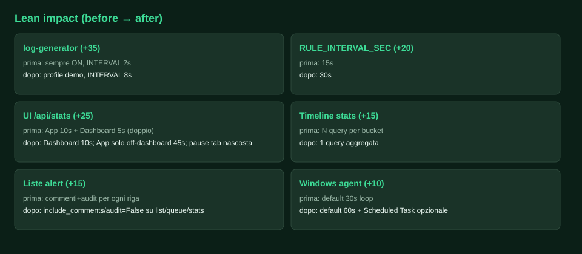
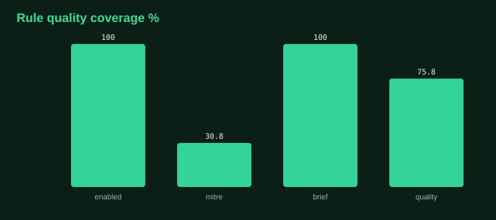
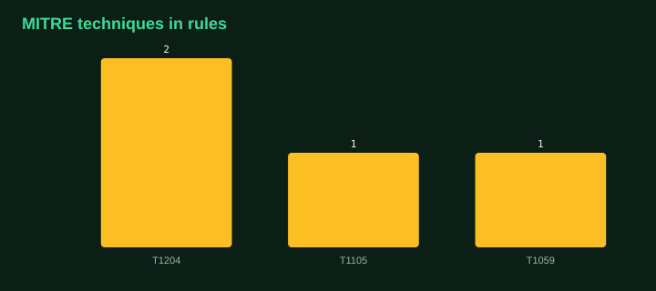
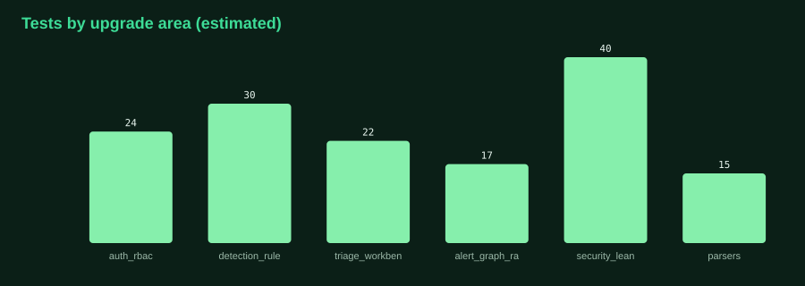

# Lab reports (pubblicati)

Snapshot reali generati da `tests/lab_proof` e dallo **stress harness**, versionati nel repo per GitHub.

## Ultimo report

| File | Link |
|------|------|
| Report Markdown (lab_proof) | [latest/report.md](latest/report.md) |
| Report HTML | [latest/report.html](latest/report.html) |
| Metriche JSON | [latest/metrics.json](latest/metrics.json) |
| **Stress mix (live)** | [latest/stress-report.md](latest/stress-report.md) |
| Metriche stress | [latest/stress-metrics.json](latest/stress-metrics.json) |
| Screenshot dashboard | [../assets/dashboard-lab.png](../assets/dashboard-lab.png) |

Ultimo stress documentato (2026-11-27, mix 1k): rules ~279 ms, p95 endpoint sotto 2s (**GREEN**). Dettaglio in [latest/stress-report.md](latest/stress-report.md).

### Grafici (lab_proof)

| Chart | Anteprima |
|-------|-----------|
| Lean impact |  |
| Rule quality |  |
| Rules by type |  |
| Rules by severity |  |
| MITRE |  |
| Tests by upgrade area |  |

## Rigenerare e pubblicare

Lab proof (regole / lean / MITRE):

```bash
python -m tests.lab_proof --with-pytest
```

Stress harness (lab Docker, mix 80/20):

```bash
python scripts/lab_stress_populate.py --events 1000 --profile mix --login --seed-dispositions 10
python scripts/lab_stress_measure.py --login
# oppure volume piu alto:
python scripts/lab_stress_populate.py --events 5000 --profile mix --login --seed-dispositions 40
```

Output in `docs/lab-reports/latest/` (e, per lab_proof, anche `tests/lab_proof/out/latest/`).

Gate CI: [../../.github/workflows/stress-lab.yml](../../.github/workflows/stress-lab.yml).

Vedi anche [../README.md](../README.md) e [../../tests/lab_proof/README.md](../../tests/lab_proof/README.md).
