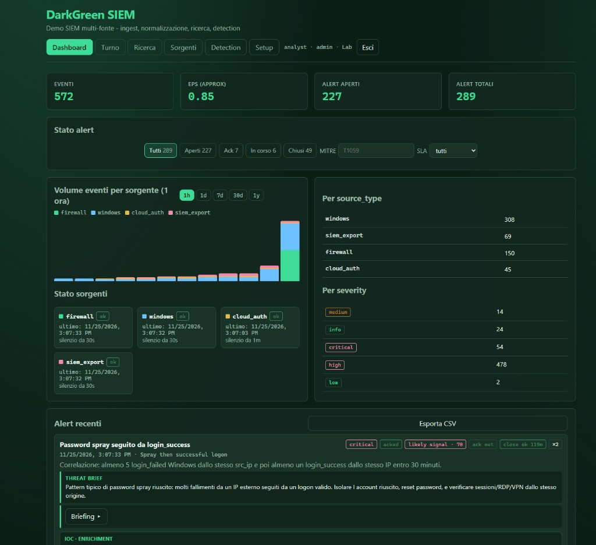
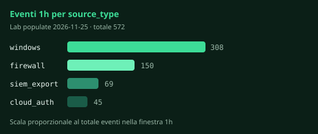
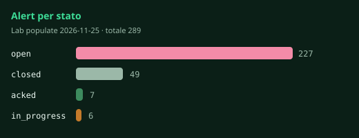

# Lab populate report - 2026-11-25

Snapshot live del lab Docker dopo due wave di ingest HTTP + `POST /api/rules/run`, usato per lo screenshot Dashboard su GitHub.

## Totali

| Metrica | Valore |
|---------|--------|
| Eventi (finestra 1h) | **572** |
| Alert totali | **289** |
| Alert aperti | **227** |
| EPS peak durante populate | **~2.77** |
| Sorgenti health | firewall / windows / cloud_auth / siem_export = **ok** |

## Eventi per sorgente

| source_type | count |
|-------------|------:|
| windows | 308 |
| firewall | 150 |
| siem_export | 69 |
| cloud_auth | 45 |

## Alert per stato

| status | count |
|--------|------:|
| open | 227 |
| closed | 49 |
| acked | 7 |
| in_progress | 6 |

## Severity (eventi/alert nel range stats)

| severity | count |
|----------|------:|
| high | 478 |
| critical | 54 |
| info | 24 |
| medium | 14 |
| low | 2 |

## Come e stato generato

1. Wave 1: **323** eventi (failed/success logon, audit cleared, firewall deny, cloud auth fail, Cynet malware/process)
2. Wave 2: **220** eventi (password spray per utente univoco, malware per host, deny hot su `10.0.0.5`)
3. `POST /api/rules/run` dopo ogni wave
4. Ack / in_progress su un sottoinsieme per variare la dashboard

Metriche grezze: [lab-populate-metrics.json](lab-populate-metrics.json) · stats API: [live-stats.json](live-stats.json)
