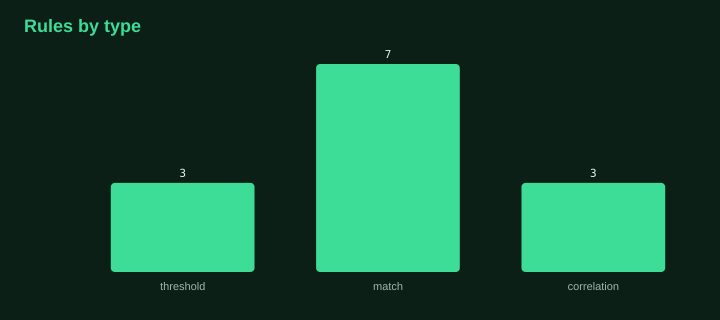
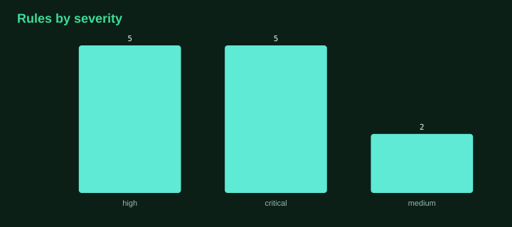
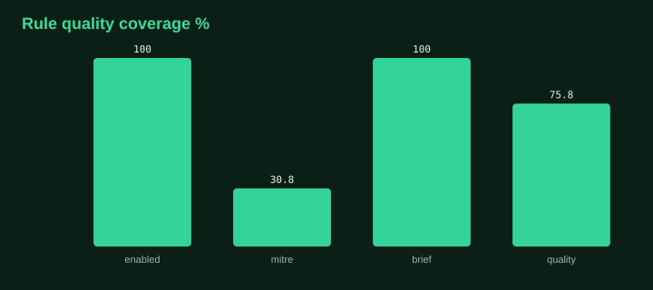
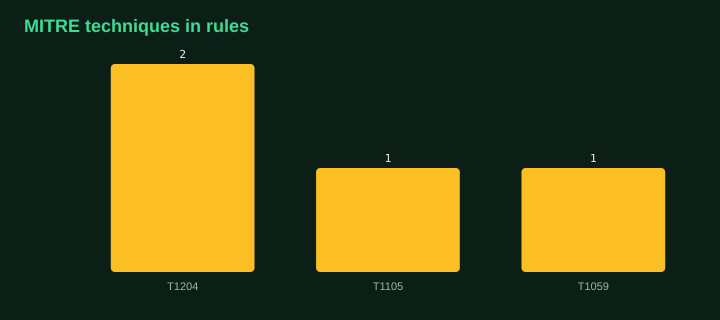
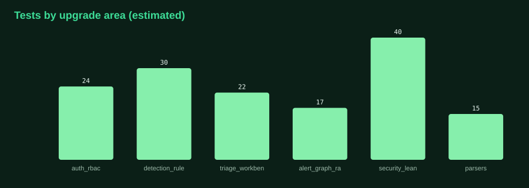
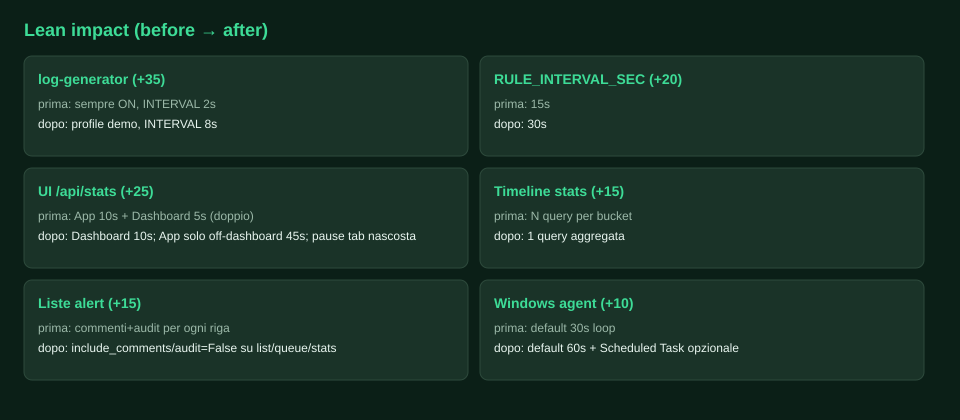

# DarkGreen SIEM - Lab proof mini-report

Generato: `2026-11-25T12:28:35.307480+00:00`

Report automatico su regole, copertura, test delle upgrade e impatto lean.

## Rule coverage

- Regole totali: **12**
- Enabled: **100.0%**
- Con MITRE: **25.0%**
- Con threat brief: **100.0%**
- Quality score (0-100): **73.8**









### Top regole per impact weight (lab)

| id | type | severity | mitre | weight |
|----|------|----------|-------|--------|
| `spray-then-malicious-ip` | correlation | critical | - | 9 |
| `spray-then-success` | correlation | critical | - | 9 |
| `cynet-malware-hash` | match | critical | T1204,T1105 | 7 |
| `malware-siem-export` | match | critical | T1204 | 7 |
| `cynet-suspicious-process` | match | high | T1059 | 6 |
| `windows-audit-cleared` | match | critical | - | 6 |
| `brute-force-windows` | threshold | high | - | 5 |
| `cloud-auth-failures` | threshold | high | - | 5 |

## Test suite (upgrade map)

- File test: **21**
- Test stimati (`def test_`): **142**



## Lean optimization impact

- Check lean passati: **9/9** (100.0%)
- Impact score documentato: **120**



| Check | OK |
|-------|----|
| `compose_has_demo_profile` | yes |
| `compose_rule_interval_30` | yes |
| `compose_mem_limits` | yes |
| `env_lean_docs` | yes |
| `installer_ps1` | yes |
| `installer_cmd` | yes |
| `installer_exe_or_build` | yes |
| `setup_guide` | yes |
| `visible_interval_hook` | yes |

## Come rigenerare

```bash
python -m tests.lab_proof.generate_report
pytest tests/test_lab_proof_report.py -q
```
