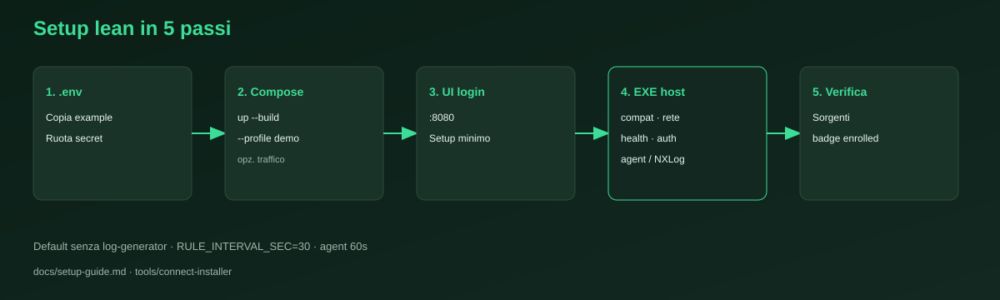

# Guida setup rapida (lean)

Obiettivo: SIEM lab su in pochi minuti, senza consumare risorse a vuoto, poi collegare i PC con l'installer.



## 1. Ambiente

```bash
cp .env.example .env
# Ruota AUTH_SECRET, SIEM_API_TOKEN, DEMO_PASSWORD
```

## 2. Avvio lean (default)

```bash
docker compose up --build
```

Senza `log-generator` (niente traffico continuo). Limiti soft su postgres/api/web.

UI: http://localhost:8080 - login `analyst` / password da `.env` (default compose: `darkgreen`).

### Traffico demo (opzionale)

```bash
docker compose --profile demo up --build
```

`INTERVAL_SEC` default 8 (vedi `.env.example`).

### Parametri lean utili

| Env | Default | Ruolo |
|-----|---------|--------|
| `RULE_INTERVAL_SEC` | `30` | Cadenza motore regole |
| `PURGE_INTERVAL_SEC` | `300` | Purge + silence |
| `RETENTION_DAYS` | `7` | Retention eventi |
| `INTERVAL_SEC` | `8` | Solo profilo `demo` |
| `HEALTH_STALE_MINUTES` | `5` | Health sorgente stale |
| `HEALTH_SILENT_MINUTES` | `30` | Health sorgente silent |

## 3. Setup minimo in UI

Tab **Setup**: retention/SLA se serve; TI/Copilot/RAG/graph opzionali. Niente obbligatorio per il primo ingest.

## 4. Collegare un PC (installer)

1. Tab **Sorgenti** → **Scarica connect-installer.zip**
2. Sul PC Windows: `DarkGreen-Setup.cmd` oppure `DarkGreen-Setup.exe` (nello zip / `dist/`)
3. Passi wizard: URL + token → compatibilità PC → rete → health → heartbeat → collezione (heartbeat / agent task / NXLog)
4. Linux: `./connect-darkgreen.sh http://SIEM:8000`

Token = valore di `SIEM_API_TOKEN`.

Dettaglio tool: [../tools/connect-installer/README.md](../tools/connect-installer/README.md).  
Collectors syslog avanzati: [collectors-windows-syslog.md](collectors-windows-syslog.md).

### Build EXE (opzionale)

Serve .NET 8 SDK:

```powershell
cd tools/connect-installer
powershell -ExecutionPolicy Bypass -File .\build_exe.ps1
```

## 5. Verifica

In **Sorgenti** il canale `connect-wizard` (o `windows-agent`) deve passare a **enrolled** entro ~15 minuti dall'ultimo evento.

Poi apri **Turno** per triage (briefing, alert collegati, copilot suggest-only).

## Link

- Architettura: [architecture.md](architecture.md)
- Indice docs: [README.md](README.md)
- README repo: [../README.md](../README.md)
